# Diffusion-Based Grasp Sampling: Code Reference

## Purpose and scope

Our project explored replacing TAMPanda's hand-designed `GraspPlanner` candidate generator with a conditional diffusion model. The model is conditioned on a 10-value vector describing the object's pose and dimensions, and predicts a 17-value representation of one grasp candidate. The integration can request and rank multiple candidates, which are checked for geometric validity and inverse-kinematics (IK) feasibility before execution. Object scope is limited to two cube sizes. DDIM and DDPM performance is compared with TAMPanda's rule-based planner.
The results are limited to the stated simulated cube sizes, checkpoint, and evaluation cohorts. They do not establish generalization to other objects (or families), but rather establish a proof of work.

## Architecture + data flow

1. **Collect demonstrations.** `data/collect_data.py` builds MuJoCo scenes with TAMPanda, samples object positions, and calls the original `GraspPlanner`. Each record contains object position, half-size, quaternion, candidate list, and dimensions. Collection is deterministic for a given seed. The default scene setup registers the cube and medium block.

2. **Encode and persist.** `data/processing.py` converts each candidate to a 17-value vector: three grasp-type indicators, a normalized quaternion, approach/grasp/lift positions, and a score. Object conditioning is a 10-value vector: position, half-size, and normalized quaternion, without any further shape information, in the form of a shape-class etc., given. Each demonstration is indexed separately. `data/storage.py` writes compressed NumPy arrays (`grasps`, `blocks`, `scene_ids`) and JSON metadata. Loading reconstructs scene records without enabling pickle. The training split is made by scene, with approximately 15% held out for validation, to avoid putting candidates from one scene in both sets.

3. **Train a denoiser.** `model/unet1d.py` defines a compact custom 1D network and an optional Diffusers 1D U-Net. The model has 31,953 parameters: it embeds the 10-value condition, concatenates it with the 17-value noisy grasp and timestep embedding, then applies 1D convolutions and two-head attention. `model/training_pytorch.py` trains it with a DDIM scheduler and clean-sample prediction. `model/training_hugging.py` trains the optional U-Net with a DDPM scheduler and epsilon prediction. Both use 10% condition dropout for classifier-free guidance, mask padded sequence positions, clip gradients, calculate validation loss, and save `best.pt`, `last.pt`, and CSV history. The result run used 2,000 scenes/4,968 labels, seed 42, a 1,700/300 scene split (4,222/746 labels), 200 epochs, batch size 32, AdamW at 1e-4, and 1,000 training timesteps, normalization was fit on training rows only. The best checkpoint was epoch 197 (validation MSE 0.277842), reached in 393.63 seconds on an RTX 3080. `model/config.py` holds command-line options, data splitting, normalization, checkpoint metadata, and validation/checkpoint helpers.

4. **Initialize, sample, validate, integrate.** `pddl/init.py` loads a format-version-2 checkpoint, builds the matching network, and selects DDPM or DDIM inference with a configurable number of steps. `pddl/checks.py` rejects malformed or implausible grasp geometry, then tests approach, grasp, and lift poses with IK while restoring simulator state. `model/grasp_planner.py` is intended as a drop-in TAMPanda planner.

The `pddl/` directory also contains baseline execution and placement helpers. `pddl/defaultMethod_performance.py` runs the original planner through approach, grasp, lift, and optionally placement, reporting success/failure fields.

## Data and tensor contracts

The collection record has the form `[position, half_size, quaternion, candidates, shape]`. Position and half-size are three-component vectors, quaternions use the `wxyz` convention and are normalized. Each candidate is stored individually for training and has the following 17-value target:

| Indices | Values | Encoding |
|---|---|---|
| 0-2 | Grasp type | One-hot: `top_down_y`, `top_down_x`, or `front` |
| 3-6 | Grasp orientation | Normalized `wxyz` quaternion |
| 7-9 | Approach position | XYZ |
| 10-12 | Grasp position | XYZ |
| 13-15 | Lift position | XYZ |
| 16 | Teacher score | Affine-scaled from the planner score |

The score transform is $y=(score+15)/40.0001$ with decoding applies $score=40.0001y-15$. The condition vector is `[position_xyz, half_size_xyz, quaternion_wxyz]`, hence $3+3+4=10$ values. Quaternion normalization also canonicalizes the sign by making its largest-magnitude component non-negative, avoiding separate representations for $q$ and $-q$.

`data/storage.py` persists one row per candidate in compressed arrays: `grasps` has shape `[N,17]`, `blocks` has shape `[N,10]`, and `scene_ids` maps each candidate row back to its scene. The training dataset presents samples as `[17,L]` and `[10,L]` tensors. Only sequence position zero contains candidate and condition values, while the remaining positions are zero padding. The custom network uses $L=4$, while the optional Diffusers U-Net uses $L=32$. The training mask makes the loss apply only to the populated position.

`model/config.py::prepare_data` shuffles scene indices deterministically from the configured seed, holds out approximately 15% of scenes, and fits the normalization statistics on training scenes only. The target and condition standard deviations are clamped to minimum values of 0.01 and 0.001 respectively. This keeps constant (or nearly constant) dimensions numerically usable and prevents validation scenes from affecting training normalization.

## Code path

The main data-to-execution path is:

```mermaid
flowchart LR
	A[collect_data.py: sample scenes and teacher grasps] --> B[processing.py: encode each candidate]
	B --> C[storage.py: save rows and scene IDs]
	C --> D[training_pytorch.py: split, normalize, train]
	D --> E[config.py: save best checkpoint and metadata]
	E --> F[pddl/init.py: load model, scheduler, condition]
	F --> G[planner adapter: request candidate batch]
	G --> H[processing.py: decode 17 values]
	H --> I[pddl/checks.py: geometry and sequential IK checks]
	I --> J[execution: approach, grasp, lift, placement]
```

In more detail, `collect_data.main` obtains teacher candidates and calls `storage.save_data` and `storage.load_data` reconstructs scene records for training. `training_pytorch.train` calls `config.prepare_data`, adds noise at sampled timesteps, drops conditions for classifier-free training, optimizes the model, evaluates validation loss, and saves checkpoints. At inference, `pddl.init.initialize` restores the model and scheduler from checkpoint metadata and prepares conditional, unconditional, and initial-noise tensors. The planner adapter converts generated 17-value rows back into `GraspCandidate` objects, rejects malformed values, applies geometric bounds, tests approach/grasp/lift IK in sequence while restoring simulator state, and sorts accepted candidates by teacher score. The execution helper then plans and executes robot motion, while the diffusion model proposes grasps rather than robot joint trajectories.

## Final test results
The parameters for the test can be found in the Test_Parameters.md.

| Final physical metric | Baseline | DDIM 100 | DDPM !00 |
|---|---:|---:|---:|
Completed tasks /60 | 58 (96.67%) | 45 (75.00%) | 48 (80.00%)
IK rejects /480 | 10 (2.08%) | 15 (3.13%) | 16 (3.33%)
Pose coverage | 100.00% | 95.83% | 97.78%
Sampling ms/candidate | 0.359 | 30.834 | 42.638

### Isolated lift results
| Sampler | 4 cm cube lifts | 6 cm cube lifts | Total lifts |
|---|---:|---:|---:|
| Rule-based baseline | 240/240 (100.0%) | 186/240 (77.5%) | 426/480 (88.8%) |
| DDIM, 100 updates | 238/240 (99.2%) | 81/240 (33.8%) | 319/480 (66.5%) |
| DDPM, 100 updates | 240/240 (100.0%) | 91/240 (37.9%) | 331/480 (69.0%) |

In the separate 60-task pick-and-place cohort, completed tasks were 58/60 (96.67%) for baseline, 45/60 (75.00%) for DDIM, and 48/60 (80.00%) for DDPM. A task required both a successful pick and final placement within 30 mm in XY and 25 mm in Z. Isolated lift success instead counts lifts of at least 25 mm among all generated candidates, including geometry and IK rejections. Sampling time is CUDA-synchronized, batch-averaged time per candidate and excludes model loading, IK planning, and physics.

There are three paired seed groups (2000, 3000, 4000), each with 20 scenes and alternating cube sizes. Isolated candidates ran in fresh scene copies. Full tasks used fresh scenes and deterministic placement goals at least 12 cm from the starting position. Learned tasks allowed up to five proposal attempts before execution. Baseline candidate trials are clustered because its finite teacher list was repeated to emit eight candidates per scene, they are not 480 independent grasps. The physical pipelines also differed in joint-space interpolation and candidate/executor policy, so task and lift gaps are not attributable solely to the sampler.

## Design questions + Evaluation

- **What conditioning is sufficient - object position and half-size, or also shape class - for the model to generalize across block geometries?** The condition contains object position, three half-sizes, and quaternion, but no class label. The reported 2,000-scene dataset contains 1,032 small (4 cm) and 968 large (6 cm) cube scenes. Their dimensions distinguish the tested geometries, orientations were close to identity. The evidence reports good teacher-pose coverage on these in-distribution sizes, but a marked size-dependent difference in physical lifting (table below). It does not establish orientation generalization or generalization across object families. Equal bounding dimensions with different contact surfaces would require a class label or richer geometry input, such as a point cloud, but here no such ablation was run.

- **How many denoising steps trade sample quality against speed, and where does DDIM beat DDPM for this task?** The matched-step sweep used one frozen checkpoint, guidance scale 3, three groups of 20 scenes, eight candidates per scene, and attachment-assisted execution. Sampling time increased with update count, while assisted picks, tasks, and pose coverage did not improve monotonically. The final physical comparison used 100 reverse updates and guidance 1 as practical settings . 1,000 updates were much slower without reliable task improvement. DDIM was faster at matched 100-step budgets: 27.299 ms/candidate versus 43.412 for DDPM in the assisted comparison, and 30.834 versus 42.638 ms/candidate in the final physical cohort. DDPM had slightly higher lift/task counts in that cohort, but the bootstrap intervals overlap. Reducing guidance from 3 to 1 without retraining raised 60-task success from 17/60 to 45/60 for DDIM and 12/60 to 48/60 for DDPM; baseline performance was unchanged. In paired scenes, DDIM improved/worsened 30/13 outcomes and DDPM 36/9. This indicates strong guidance sensitivity in this cohort. A held-out physical sweep would be needed to select a globally optimal step count.

- **hould the model output full grasp poses or a reduced parameterization, and how does that choice affect the IK rejection rate?** The 17-value output is a native grasp proposal, not a robot joint trajectory: type (top-down-y, top-down-x, or front), quaternion, approach/grasp/lift positions, and teacher score. Keeping the native candidate interface avoids adding a learned motion planner, but the model must learn three related world-frame waypoints and does not explicitly enforce finger enclosure, object-relative offsets, or force closure. In the final 480-candidate physical cohort, IK rejection was 10/480 (2.08%) for baseline, 15/480 (3.13%) for DDIM, and 16/480 (3.33%) for DDPM, thus a reduced Most generated waypoints were reachable, although later contact or lift could still fail. No reduced-output comparison was run, so these results do not establish a causal effect of representation on IK rejection.

- **Does the learned sampler cover the same valid grasps as the rule based sampler, or collapse onto a few modes?** All three methods generated the three grasp labels found in the teacher data, so the learned methods did not collapse to a single discrete label. Reported teacher-pose coverage was 100.00% for baseline, 95.83% for DDIM, and 97.78% for DDPM. Coverage means an accepted candidate is within 2.5 cm and 20 degrees of an IK-valid teacher pose at all three waypoints. It is geometric coverage, not a physical diversity measure. Front grasps show an overall performance drop: learned front candidates produced 0/75 DDIM and 0/83 DDPM physical lifts, while teacher front candidates lifted 12/60. So for the overall performance it shows a high performance similarity, while not complete equivalence.

